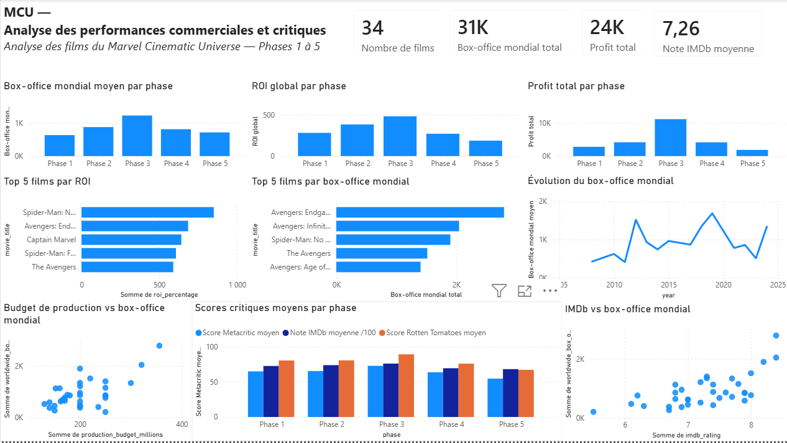

# MCU Data Analytics — Commercial and Critical Performance of Marvel Films

Personal data analysis project on the commercial and critical performance of **34 Marvel Cinematic Universe (MCU) films released between 2008 and 2024** (Phases 1 to 5, from *Iron Man* to *Deadpool & Wolverine*).

The analysis is framed by a fictional business brief written for practice. It is not client work.

## Workflow

| Step | Tool | File |
|---|---|---|
| Profiling and data-quality checks | Python / Pandas | [`01_profilage.py`](01_profilage.py) |
| Cleaning (`release_date` converted to a date type) | Python / Pandas | [`02_nettoyage.py`](02_nettoyage.py) |
| Exploratory data analysis and charts | Python / Pandas / Matplotlib | [`03_eda.py`](03_eda.py) |
| Key indicators and insights | Python / Pandas | [`04_insights.py`](04_insights.py) |
| Star-schema model, DAX measures and dashboard | Power BI Desktop | [`PowerBI_Source/MCU_Data_Analytics.pbix`](PowerBI_Source/MCU_Data_Analytics.pbix) |
| Analysis report (French and English) | LaTeX | [`PowerBI_Source/utbmciad-report/`](PowerBI_Source/utbmciad-report/) |

The Python scripts and the reports are written in French; an English version of the report is provided.

## Dataset

- 34 films, 20 columns: release dates, MCU phase, director, lead actor, runtime, production budget, worldwide and domestic box office, profit, ROI, IMDb, Rotten Tomatoes and Metacritic scores.
- Public dataset downloaded from Kaggle. Its bundled documentation ([`DATASET_README.md`](DATASET_README.md), [`data_dictionary.csv`](data_dictionary.csv)) lists IMDb, Box Office Mojo, Rotten Tomatoes and Wikipedia as sources. The values are used as provided and were not re-checked against those sources.
- Files: [`marvel_movies_dataset.csv`](marvel_movies_dataset.csv) (raw data used by the scripts), plus the same data in `.json` and `.xlsx`; [`PowerBI_Source/marvel_movies_dataset_clean.csv`](PowerBI_Source/marvel_movies_dataset_clean.csv) (cleaned output of `02_nettoyage.py`, used by Power BI).
- Data-quality checks in `01_profilage.py`: no missing values, no duplicates, 34 unique IDs, consistent phase / date fields, and profit, ROI and domestic share consistent with their formulas.

## Key findings

Figures produced by `04_insights.py` (amounts in millions of US dollars):

- Total production budget 6,947; total worldwide box office 31,129; total calculated profit 24,182.
- Average ROI per film 339.58 %; overall ROI (total profit / total budget) 348.09 %.
- Phase 3 has the highest average worldwide box office (1,227.27), the highest overall ROI (481.65 %) and the highest average critic scores. Phase 5 has the lowest overall ROI (186.50 %).
- Correlation with worldwide box office: production budget 0.63, IMDb rating 0.66, Rotten Tomatoes 0.44, Metacritic 0.42.

These are descriptive associations on 34 films, not causal effects. "Profit" here is worldwide box office minus production budget: it excludes marketing, distribution and other costs, so it is not studio accounting profit.

## How to run

Requirements: Python 3 and the packages in [`requirements.txt`](requirements.txt).

```bash
git clone https://github.com/MediJr/MCU-Data-Analytics.git
cd MCU-Data-Analytics
python -m venv .venv
.venv\Scripts\activate
pip install -r requirements.txt
```

Run the scripts from the repository root, in this order:

```bash
python 01_profilage.py
python 02_nettoyage.py
python 03_eda.py
python 04_insights.py
```

- `02_nettoyage.py` writes `marvel_movies_dataset_clean.csv` at the repository root; `03_eda.py` and `04_insights.py` read that file, so run step 2 first.
- `03_eda.py` opens seven Matplotlib windows one after another; close each window to continue.
- On Windows, if you redirect the output to a file, run the scripts with `python -X utf8` to avoid encoding errors on accented characters and arrows.
- `analysis_script.py` is the example script shipped with the dataset. It is not part of this project's pipeline and also needs `seaborn`.

## Power BI dashboard

Open `PowerBI_Source/MCU_Data_Analytics.pbix` in Power BI Desktop. The model is a star schema (`Fact_Movie`, `Dim_Movie`, `Dim_Phase`, `Dim_Date`) with DAX measures such as total box office, total profit, overall ROI and average critic scores. If Power BI cannot find the source file, point the data source to `PowerBI_Source/marvel_movies_dataset_clean.csv`.

Dashboard overview (all 34 films, no filter):



## Reports

- French: [`MCU_Analyse_Performances_Commerciales_Critiques_FR.pdf`](PowerBI_Source/utbmciad-report/MCU_Analyse_Performances_Commerciales_Critiques_FR.pdf)
- English: [`MCU_Commercial_Critical_Performance_Analysis_EN.pdf`](PowerBI_Source/utbmciad-report/MCU_Commercial_Critical_Performance_Analysis_EN.pdf)

Build instructions are in [`PowerBI_Source/utbmciad-report/README.md`](PowerBI_Source/utbmciad-report/README.md).

## Author

Lumu Bamana Manassé — [github.com/MediJr](https://github.com/MediJr)
